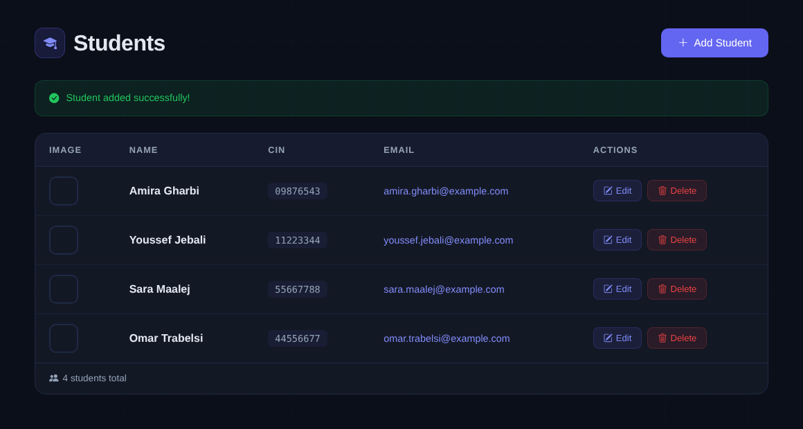
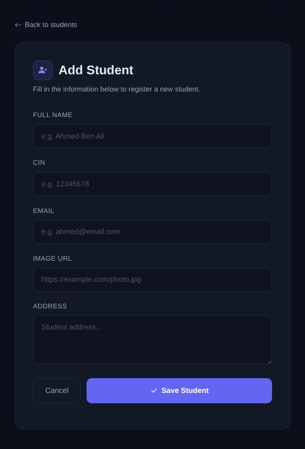

# Gestion des étudiants — PHP / MySQL

> *Student management CRUD web app in PHP (PDO, prepared statements) with a custom dark Bootstrap 5 UI.*

Application web de gestion des étudiants : liste, ajout, modification et suppression, avec une interface sombre entièrement repensée (Bootstrap 5, Bootstrap Icons).

| Liste des étudiants | Formulaire d'ajout |
|---|---|
|  |  |

## Fonctionnalités

- **CRUD complet** sur la table `Students` (nom, CIN, email, photo, adresse)
- **Requêtes préparées PDO** (`bindParam`) contre les injections SQL
- **Échappement des sorties** (`htmlspecialchars`) contre le XSS
- Vérification de l'existence de l'étudiant avant modification / suppression, confirmation avant suppression
- Messages de retour (succès / erreur) après chaque action
- Configuration de la base par variables d'environnement (`DB_DSN`, `DB_USER`, `DB_PASS`)

## Lancer le projet

1. Avec XAMPP (ou tout serveur MySQL), importer `schema.sql` dans phpMyAdmin.
2. Copier le dossier dans `htdocs/` puis ouvrir `http://localhost/php-student-management/`.

Ou avec le serveur intégré de PHP :

```bash
mysql -u root < schema.sql
php -S localhost:8000      # puis http://localhost:8000
```

## Structure

| Fichier | Rôle |
|---|---|
| `config.php` | Connexion PDO à MySQL |
| `index.php` | Liste des étudiants et messages de retour |
| `add_student.php` | Formulaire et insertion |
| `edit_students.php` | Chargement, formulaire pré-rempli et mise à jour |
| `delete_students.php` | Vérification et suppression |
| `schema.sql` | Création de la base et données de démonstration |

---

Projet académique — Programmation web PHP, TED University · **Luca Raciti** · [LinkedIn](https://www.linkedin.com/in/raciti-luca)
